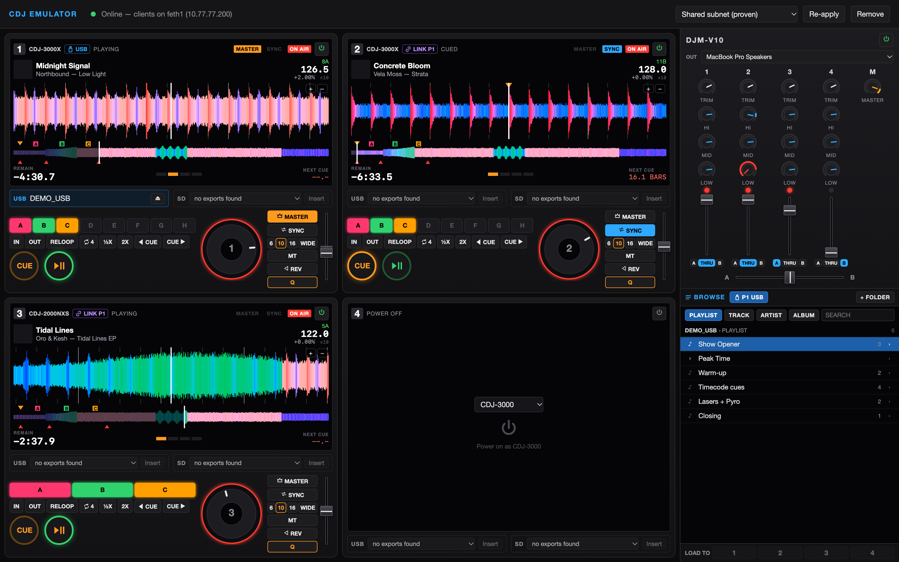
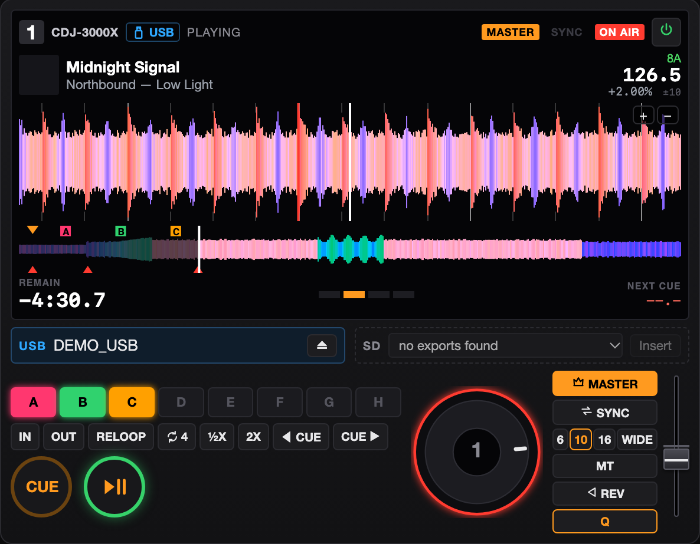
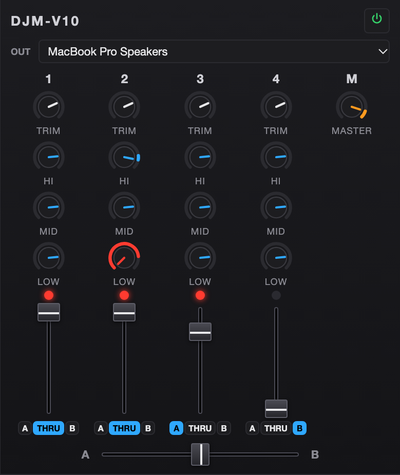
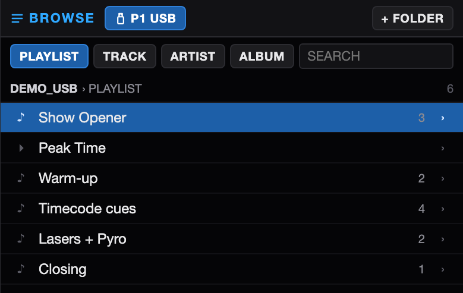
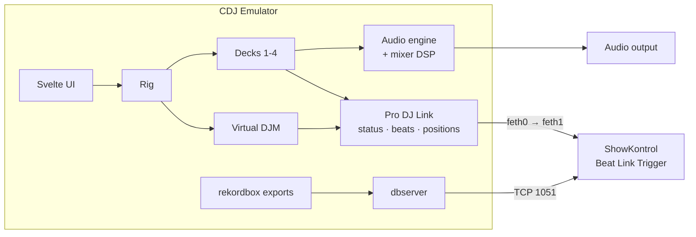

# CDJ / DJM Emulator

[](#requirements)
[](https://www.rust-lang.org)
[](https://tauri.app)
[](https://svelte.dev)
[](https://www.typescriptlang.org)
[](#how-it-works)
[](#progress)
[](#license)

A macOS app that runs up to **4 virtual CDJ players and 1 virtual DJM mixer**
on a Pro DJ Link network inside your Mac, so that **ShowKontrol**, **Beat Link
Trigger** and other Pro DJ Link software see a credible DJ setup without any
physical hardware. Decks load tracks from rekordbox exports on external
drives or in folders, play them
through a virtual mixer, and report everything (status, beats, playhead, track
metadata, waveforms) on the network the way real players do.

**Why:** to test the data path a show actually runs on, without CDJs on the
desk. ShowKontrol R27 (October 2026) can already build cue timelines at home
with its Internal Players, but those decks exist only inside ShowKontrol. This
rig puts players and a mixer on the network, so you can check:

- **Beat Link Trigger** shows, triggers and expressions against live players
  (its own simulator works only offline);
- **TCNet** consumers such as Resolume or a lighting desk, fed by ShowKontrol
  or the PRO DJ LINK Bridge;
- **DJM data**: on-air, channel faders and fader start;
- **rekordbox USB data the way players report it**: rekordbox IDs, titles,
  beat grids, cues and waveforms over the dbserver;
- **ShowKontrol's Pro DJ Link input**, including the free Core edition (which
  has no Internal Players), and whether a show programmed at home fires when
  the titles come from players;
- **your own Pro DJ Link software**, by hand or headless in CI.

ShowKontrol and the Bridge haven't been tested against the rig yet; see
[Progress](#progress).


<sub>Four decks (two CDJ-3000X, a CDJ-2000NXS, one switched off with its model picker), the DJM-V10 and the browser. Shown in the UI's preview mode with demo tracks.</sub>

## Contents

- [CDJ / DJM Emulator](#cdj--djm-emulator)
  - [Contents](#contents)
  - [Progress](#progress)
  - [Features](#features)
  - [Supported models](#supported-models)
  - [Getting started](#getting-started)
    - [Requirements](#requirements)
    - [Run the app](#run-the-app)
    - [First steps in the app](#first-steps-in-the-app)
  - [Command line](#command-line)
  - [How it works](#how-it-works)
  - [Testing and verification](#testing-and-verification)
  - [Known limits](#known-limits)
  - [Project layout](#project-layout)
  - [Credits](#credits)
  - [License](#license)

## Progress

| | Area | State |
| --- | --- | --- |
| ✅ | Pro DJ Link packets (announce, claim, status, beat, absolute position, mixer, on-air, handoff, sync) | Byte-for-byte against beat-link's own templates and parsers |
| ✅ | Rig: switch players 1-4 and the mixer on and off at runtime | Done |
| ✅ | Virtual network (`feth` pair) set up from the app with one password prompt | Done |
| ✅ | Live run against beat-link (the library inside Beat Link Trigger) | Sees all devices, status, beats, positions, mixer data; fetches metadata, beat grids and waveforms |
| ✅ | Media: a media slot per player, LINK loading between players, browsing, dbserver | Done; dbserver checked with beat-link's own client |
| ✅ | Deck engine: CUE, hot cues, memory cues, loops, tempo, sync, master, reverse, quantize | Done |
| ✅ | Audio engine: one output, mixer DSP (trim, 3-band EQ, faders, crossfader), master tempo (key lock) | Done |
| ✅ | CDJ-style UI: deck screens with rekordbox waveforms, jog wheel, DJM mixer, browser | Done |
| ✅ | Model picker: 6 player models, 4 mixer models | Done; some per-model details are educated guesses |
| 🟡 | Compare against real gear (CDJ-3000X ×2, DJM-A9) | Capture script ready, recordings pending |
| 🟡 | ShowKontrol end-to-end | R27 sees the players and mixer, positions and on-air; no titles, artwork or waveforms yet (see Known limits) |
| ✅ | Commands from client apps: tempo-master handoff, sync, fader start, load track, media queries | Done; each one checked live with beat-link |
| ⬜ | NFS file sharing | Only if ShowKontrol turns out to need it |
| ⬜ | Signed `.app`, saving sessions, MIDI control, Windows | Later |

## Features

<table>
<tr>
<td width="60%"></td>
<td width="40%"></td>
</tr>
</table>

**Decks**
- Screen with title, artist, key, BPM, tempo %, time/remain, beat-in-bar and
  bars to the next memory cue.
- Scrolling waveform in rekordbox's colours with the beat grid, cue points
  and loops; whole-track overview you click to jump (needle search).
- CUE with hold-to-preview, hot cues A-H (in their rekordbox colours;
  right-click clears one) and memory cues from rekordbox, beat loops, loop
  in/out (IN also sets the cue point, as on a CDJ), reloop, ½× / 2×.
- Tempo fader with ±6 / 10 / 16 / WIDE (double- or right-click: 0%), master
  tempo (key lock, switched without a gap or a jump), reverse,
  quantize, SYNC and MASTER, and a jog wheel (scrub when paused, nudge when
  playing).
- Beats follow the track's rekordbox beat grid; each beat packet goes out
  when that beat is heard (measured within about 1 ms).

**Mixer**
- Trim, 3-band EQ with kill, channel faders, crossfader with A / THRU / B
  assign, master level, on-air lights.
- On-air state goes to the players and to client apps, as on a real DJM.
- The mix plays through one audio output of your choice (speakers,
  BlackHole, an interface) or muted.



**Media and browsing**
- One media slot on every player (client apps see it as the player's USB
  slot). Exports on mounted drives are found automatically; any export
  folder can be added.
- Any player loads from any other player's media over LINK.
- Browser with playlists and folders, tracks, artists, albums and search;
  keyboard navigation like a CDJ's rotary; LOAD TO deck 1-4.
- The dbserver serves metadata, artwork, beat grids, cues, waveforms and
  menus to client apps.

<br clear="right">

**Commands from client apps**

The players take the commands Beat Link Trigger (and other Pro DJ Link
apps) send to real CDJs:
- **Tempo master** in both directions: a client asks the master player for
  the role and gets it; pressing MASTER on a player while a client is master
  asks the client for it, and synced players follow a client master's tempo
  and beat.
- **Sync** on / off and "become master".
- **Fader start**: play, or back to the cue point and stop.
- **Load track** from any player's media (over LINK), acknowledged as a
  player does.
- **Media queries**: what is in a slot (name, date, track and playlist
  counts, size and free space).

The **Commands** button in the header shows whether the players are
listening, a client app that holds tempo master, and the latest commands.

## Supported models

Pick a model per player and for the mixer when switching it on.

| Player | Name on the network | Status packet | Position packets | Hot cues |
| --- | --- | --- | --- | --- |
| CDJ-3000 | `CDJ-3000` | 512 bytes | ✓ | 8 |
| CDJ-3000X | `CDJ-3000X` (unverified) | 512 bytes | ✓ | 8 |
| CDJ-2000NXS2 | `CDJ-2000NXS2` | 284 bytes | | 8 |
| CDJ-2000NXS | `CDJ-2000nexus` | 212 bytes | | 3 |
| CDJ-2000 | `CDJ-2000` (pre-nexus) | 208 bytes | | 3 |
| XDJ-1000MK2 | `XDJ-1000MK2` | 284 bytes (unverified) | | 8 |

| Mixer | Channels |
| --- | --- |
| DJM-V10 | 6 (the emulator's EQ is 3-band; the V10 has 4) |
| DJM-A9 | 4 |
| DJM-900NXS2 | 4 |
| DJM-750MK2 | 4 |

Only what's publicly known to differ on the network is modelled. Firmware
version strings are placeholders. `cdjd models` lists what's still a guess.

## Getting started

### Requirements

- macOS (Apple Silicon or Intel) and an administrator password (for the
  virtual network).
- To build: Rust 1.77+, Node.js 20.19+ and the Xcode Command Line Tools.
- Optional: [Beat Link Trigger](https://github.com/Deep-Symmetry/beat-link-trigger)
  and Java 17+ (cross-check tests, probe), Wireshark (captures).

### Run the app

```sh
npm --prefix ui install
npm --prefix ui run tauri dev
```

The first launch compiles for a minute or two. To build a standalone app
instead: `npm --prefix ui run tauri build` (an unsigned `CDJ Emulator.app`
in `ui/src-tauri/target/release/bundle/macos/`).

### First steps in the app

1. **Network:** if the top bar doesn't say *Online*, click **Set up network**
   and enter your password. This creates the virtual cable.
2. **Power on:** on each deck pick a model and click **Power on as …**; same
   for the mixer (top right).
3. **Insert media:** plug in a drive with a rekordbox export and pick it in a
   deck's **MEDIA** slot, or add a folder with **+ FOLDER** in BROWSE. To try it
   without a stick: `app/vendor/rekordcrate/data/complete_export/demo_tracks`
   (two demo tracks with analysis but no audio: they play silently and still
   send beats).
4. **Load and play:** select a track in **BROWSE**, press **LOAD TO 1-4**, play.
   Choose the audio output under the mixer's **OUT**.
5. **Connect your show software:** point ShowKontrol or Beat Link Trigger at
   the interface **feth1** (`10.77.77.200`).

`npm --prefix ui run dev` opens the UI in a normal browser with demo data
(no network, no audio) for working on the interface.

## Command line

```sh
cd app
cargo run --bin cdjd -- net-up              # create the virtual network (password prompt)
cargo run --bin cdjd -- run-fleet --library /Volumes/MY_USB
cargo run --bin cdjd -- run-fleet --autoplay --silent   # timecode only, no tracks
cargo run --bin cdjd -- run-fleet --player-model CDJ-3000X,CDJ-3000X,CDJ-2000NXS2 --mixer-model DJM-A9
cargo run --bin cdjd -- models              # player and mixer models
cargo run --bin cdjd -- audio-devices       # outputs for --audio-device
cargo run --bin cdjd -- net-down            # remove the virtual network
```

`run-fleet --library` puts the export in player 1's USB slot and loads its
first tracks onto the players (2-4 over LINK). `feth-plan` prints the network
commands instead of running them.

## How it works



- **One audio engine owns every playhead**, so loops, cue jumps and track
  ends happen on the exact sample, and each beat is stamped with the moment
  it will be heard. The network side sends the beat packet at that moment.
- **Each device has its own IP address** on the emulator side of a macOS
  `feth` pair (a virtual Ethernet cable); client apps listen on the other side.

| Interface | Addresses | Who |
| --- | --- | --- |
| `feth0` | `10.77.77.1`-`.4` (players), `.33` (mixer) | the emulator |
| `feth1` | `10.77.77.200` | ShowKontrol, Beat Link Trigger |

Network details (all handled by the setup):
- The subnet's route belongs to `feth1` so client apps reach the devices; an
  extra route scoped to `feth0` lets the emulator reach the client apps.
- Discovery packets (claims, keep-alives) are broadcast; status, beats,
  positions and mixer packets go straight to `10.77.77.200`, because macOS
  hands a sender a local copy of every broadcast on a virtual interface and a
  client on the same Mac would otherwise get everything twice.
- Players listen for commands on their own address (and the broadcast
  address) on UDP 50001-50002, **only while a client app holds those
  ports**. macOS lets these sockets share a port with Beat Link Trigger's
  wildcard sockets only if Beat Link Trigger bound first, so the emulator
  checks every 250 ms, binds after a client does, and lets go when it
  leaves; a client can start, stop and restart at any time. The emulator
  never binds UDP 50000. Beat Link Trigger warns that `feth0` sees the same
  network; that is expected and harmless.

## Testing and verification

```sh
cd app && cargo test --workspace     # 75 core + 56 protocol tests, 4 beat-link cross-checks
```

- **Packets** are checked byte for byte against the templates beat-link
  sends itself, and parsed back by beat-link's own classes.
- **dbserver** replies are read by beat-link's own client, using the real
  rekordbox demo export in `app/vendor/rekordcrate/data`.
- These cross-checks run when Beat Link Trigger is installed (or
  `BEATLINK_JAR` is set) and Java is on the PATH; otherwise they skip.

**On a live setup** (Beat Link Trigger closed, rig running):

```sh
java -cp "/Applications/Beat Link Trigger.app/Contents/app/beat-link-trigger.jar" \
    app/tools/beatlink-probe/Probe.java 15
```

goes online like Beat Link Trigger and reports the devices, status, beats,
positions, mixer data and track data it gets.

```sh
cdjd run-fleet --players 3 --silent --library app/vendor/rekordcrate/data/complete_export/demo_tracks
java -cp "/Applications/Beat Link Trigger.app/Contents/app/beat-link-trigger.jar" \
    app/tools/beatlink-probe/Commands.java
```

sends every command Beat Link Trigger can send (media query, load track,
sync, master handoff both ways, fader start/stop) and checks each one in the
players' status.

**Against real gear:** with CDJs, a DJM and this Mac on one switch,
`app/tools/capture-cdj.sh <interface>` records power-on, loading, mixing,
master/sync and deck controls, one file per step, into `captures/`
(git-ignored: recordings contain your devices' MAC addresses).

## Known limits

- The load-track acknowledgment's layout isn't documented; beat-link only
  reads who sent it. A capture from a real CDJ would confirm the rest.
- ShowKontrol R27 shows only track numbers: it sends each player packets of
  kind 0x68 (about every second) and 0x6b (about every 5 s) on UDP 50002,
  which aren't publicly documented, gets no answer, and never connects for
  track data. Scenario 11 in [realdata.md](realdata.md) captures what real
  players answer.
- No NFS file sharing; clients use the dbserver.
- Model differences beyond those listed above (per-model menus, the
  DJM-V10's 4-band EQ, older players' track-data limits) aren't emulated.
- Not yet compared against captures of real units.
- macOS only.

## Project layout

```text
app/                      Rust workspace
  crates/
    cdj-proto/            Pro DJ Link packet codecs (no I/O)
    cdj-core/             Rig, decks, audio engine, mixer, media, dbserver, network, models
    cdjd/                 Command line
  vendor/rekordcrate/     rekordcrate 0.3.0 with some fields made public
  tools/
    beatlink-probe/       Goes online with beat-link and reports what it sees
    capture-cdj.sh        Guided capture of real gear
ui/                       Tauri app: Svelte UI (src/) and Rust shell (src-tauri/)
docs/screenshots/         README images
```

## Credits

- [Deep-Symmetry](https://github.com/Deep-Symmetry): the dysentery protocol
  analysis, beat-link and crate-digger, which made this possible.
- [rekordcrate](https://github.com/Holzhaus/rekordcrate) for reading rekordbox
  exports, [Symphonia](https://github.com/pdeljanov/Symphonia) for decoding,
  [CPAL](https://github.com/RustAudio/cpal) for audio output,
  [Signalsmith Stretch](https://github.com/Signalsmith-Audio/signalsmith-stretch)
  for master tempo, [Tauri](https://tauri.app) and [Svelte](https://svelte.dev)
  for the app.

## License

Source code: MIT OR Apache-2.0, at your option; see [LICENSE.md](LICENSE.md).
The vendored rekordcrate is MPL-2.0; Signalsmith Stretch is MIT.

This is a **clean-room implementation of the Pro DJ Link protocol**, based on
the public analysis by the Deep-Symmetry project (dysentery, beat-link,
crate-digger). No Pioneer / AlphaTheta firmware or source code is part of
this repository, linked or redistributed. The UI uses its own icons and
artwork. CDJ, DJM, rekordbox and Pro DJ Link are trademarks of AlphaTheta
Corporation; this project is not affiliated with or endorsed by them.
